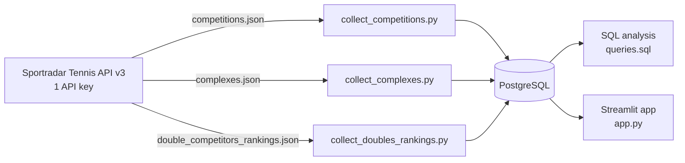
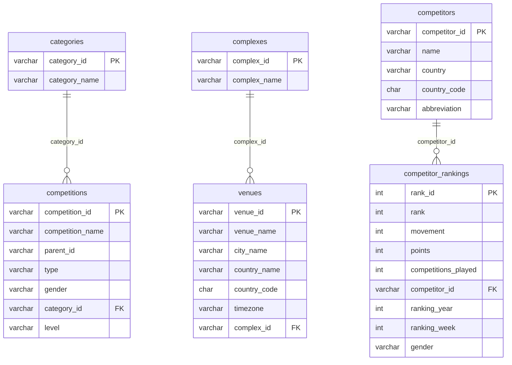

# 🎾 Game Analytics: Unlocking Tennis Data with Sportradar API

An end-to-end data project: collect tennis data from the **Sportradar Tennis API**, store it in a relational **PostgreSQL** database, analyse it with **SQL**, and explore it in an interactive **Streamlit** dashboard.

### 🔗 Live app: [Tennis Analytics Explorer](https://tennis-analytics-sportradar-gudapp7qnkhy8knuanqjg8v.streamlit.app/)

> **Domain:** Sports / Data Analytics  **Skills:** Python scripting · API integration · SQL (PostgreSQL) · Streamlit

---

## 📌 Table of contents
1. [Project overview](#-project-overview)
2. [Features](#-features)
3. [Architecture](#-architecture)
4. [Tech stack](#-tech-stack)
5. [Data source: one API key, three endpoints](#-data-source-one-api-key-three-endpoints)
6. [Database design](#-database-design)
7. [Project structure](#-project-structure)
8. [Setup and installation](#-setup-and-installation)
9. [SQL analysis](#-sql-analysis)
10. [Streamlit app pages](#-streamlit-app-pages)
11. [Deployment](#-deployment)
12. [Error handling](#-error-handling)
13. [Challenges and solutions](#-challenges-and-solutions)
14. [Insights](#-insights)
15. [Future improvements](#-future-improvements)

---

## 📖 Project overview
Sports organisers, analysts and fans need a clear view of how tennis competitions are structured and how players and doubles teams rank. This project turns raw, deeply nested Sportradar JSON into a clean relational database and a dashboard that answers questions such as:

- Which competitions exist, in which categories, and how are they nested (parent → sub-competition)?
- Which complexes and venues host tennis, and in which countries and time zones?
- Who are the top-ranked doubles competitors, which countries are strongest, and who moved this week?

**Business use cases:** event exploration · trend analysis · performance insights · decision support.

## ✨ Features
- **Automated data collection** from the Sportradar Tennis API with retries, rate-limit handling and clear error messages.
- **JSON → relational transformation** into 6 normalised tables with primary keys, foreign keys and indexes.
- **Upserts**, so collectors can be re-run safely without duplicating data.
- **20 SQL analysis queries** (plus bonus queries) written for PostgreSQL.
- **Interactive Streamlit dashboard** with filters, search, pagination, charts and leaderboards.
- **Cloud deployment:** Streamlit Community Cloud + Neon (hosted PostgreSQL).

## 🏗️ Architecture


## 🛠️ Tech stack
| Layer | Tools |
|---|---|
| Language | Python 3 |
| API calls | `requests` |
| Database | PostgreSQL (local) · Neon (cloud) |
| DB access | `psycopg2`, `SQLAlchemy`, `pandas` |
| App | Streamlit |
| Config | `python-dotenv` (local) · Streamlit Secrets (cloud) |

## 🔌 Data source: one API key, three endpoints
The project uses the **Sportradar Tennis API (v3)**. A **single API key** is used for everything; the data is collected from three endpoints of that same API:

| Step | Endpoint | Script | Tables filled |
|---|---|---|---|
| 1. Competitions | `/tennis/{access_level}/v3/{language}/competitions.json` | `collect_competitions.py` | `categories`, `competitions` |
| 2. Complexes | `/tennis/{access_level}/v3/{language}/complexes.json` | `collect_complexes.py` | `complexes`, `venues` |
| 3. Doubles competitor rankings | `/tennis/{access_level}/v3/{language}/double_competitors_rankings.json` | `collect_doubles_rankings.py` | `competitors`, `competitor_rankings` |

The key is read from the `SPORTRADAR_API_KEY` variable in a local `.env` file. It is never committed to Git, and the deployed app does not need it (it only reads from the database).

**Data loaded in this project**

| Table | Rows |
|---|---|
| categories | 18 |
| competitions | 6,706 |
| complexes | 781 |
| venues | 4,144 |
| competitors | 1,000 |
| competitor_rankings | 1,000 |

## 🗄️ Database design


**Design notes**
- Tables follow the project specification, with extra columns where the API data needs them: `competitions.level` (e.g. grand slam, ATP 1000) and `ranking_year`, `ranking_week`, `gender` on `competitor_rankings` so weeks and genders can be filtered.
- `competitor_rankings` has a unique key on `(competitor_id, ranking_year, ranking_week, gender)`, which makes weekly re-loads safe.
- `parent_id` in `competitions` is nullable (top-level competitions have no parent).
- **Indexes** on foreign keys and commonly filtered columns (`category_id`, `parent_id`, `type`, `level`, `country_name`, `rank`, `country`).
- **View `v_latest_rankings`** returns the most recent ranking week for each gender, joined with competitor details. The app uses it for "current week" analysis.
- Missing values from the API are stored with defaults (e.g. `Unknown`, `UNK`) to respect the `NOT NULL` constraints.
- Doubles "competitors" can be teams (e.g. `Surname A / Surname B`), as defined by Sportradar.

## 📁 Project structure
```
.
├── app.py                        # Streamlit dashboard
├── common.py                     # API key, HTTP calls with retries, DB connection, upsert helpers
├── collect_competitions.py       # Endpoint 1 -> categories, competitions
├── collect_complexes.py          # Endpoint 2 -> complexes, venues
├── collect_doubles_rankings.py   # Endpoint 3 -> competitors, competitor_rankings
├── run_all.py                    # Runs the three collectors in order
├── schema.sql                    # Tables, indexes, view
├── queries.sql                   # All SQL analysis queries
├── requirements.txt              # Python dependencies
├── .env.example                  # Template for local configuration
├── .gitignore                    # Keeps .env and dump files out of Git
└── README.md
```

## ⚙️ Setup and installation

### 1. Prerequisites
- Python 3.9+
- PostgreSQL 14+ (pgAdmin recommended)
- A Sportradar developer account with a **Tennis v3** key: <https://console.sportradar.com/signup>

### 2. Clone and install
```bash
git clone https://github.com/<your-username>/tennis-analytics-sportradar.git
cd tennis-analytics-sportradar
python -m venv venv
venv\Scripts\activate          # Windows   (Mac/Linux: source venv/bin/activate)
pip install -r requirements.txt
```

### 3. Create the database and tables
```sql
CREATE DATABASE tennis_db;
```
Then run `schema.sql` against `tennis_db` (pgAdmin Query Tool, or `psql -U postgres -d tennis_db -f schema.sql`).

### 4. Configure environment variables
Copy `.env.example` to `.env` and fill it in:
```env
SPORTRADAR_API_KEY=your_key_here        # key string only, not the endpoint URL
SPORTRADAR_ACCESS_LEVEL=trial           # trial | production
SPORTRADAR_LANGUAGE=en

PG_HOST=localhost
PG_PORT=5432
PG_DATABASE=tennis_db
PG_USER=postgres
PG_PASSWORD=your_postgres_password
# PG_SSLMODE=require                    # only for cloud databases such as Neon
```

### 5. Collect the data
```bash
python run_all.py
```
Or run the three collectors separately:
```bash
python collect_competitions.py
python collect_complexes.py
python collect_doubles_rankings.py
```
Trial keys allow about one request per second, so the scripts pause between calls.

### 6. Launch the app
```bash
streamlit run app.py
```
Open <http://localhost:8501>.

## 🧮 SQL analysis
All queries are in [`queries.sql`](queries.sql), written for PostgreSQL.

**Competitions**
1. All competitions with their category name
2. Number of competitions per category
3. All competitions of type `doubles`
4. Competitions in a specific category (e.g. ITF Men)
5. Parent competitions and their sub-competitions
6. Distribution of competition types by category
7. Top-level competitions (no parent)

**Complexes and venues**
1. Venues with their complex name
2. Number of venues per complex
3. Venues in a specific country (e.g. Chile)
4. Venues and their time zones
5. Complexes with more than one venue
6. Venues grouped by country
7. Venues of a specific complex (e.g. Nacional)

**Doubles rankings**
1. Competitors with rank and points
2. Top 5 competitors
3. Competitors with no rank movement
4. Total points for a country (e.g. Croatia)
5. Number of competitors per country
6. Highest points in the current week

**Bonus:** competitions by level, country-wise average points, biggest rank movers.

## 🖥️ Streamlit app pages
| Page | What it shows |
|---|---|
| 🏠 Home | Total competitors, countries represented, highest points, competitions per category, competition types |
| 🏆 Competitions | Filters for type, gender, category, level and hierarchy; paginated table; parent → sub-competition view |
| 🏟️ Venues & Complexes | Filters by country and complex; venues per country chart |
| 🔎 Search Competitors | Name search, rank range, minimum points, country; competitor detail card with rank history chart |
| 🌍 Country Analysis | Competitors, total points and average points per country |
| 📊 Leaderboards | Top-ranked competitors and highest-points competitors |

Performance: results are cached for 5 minutes, queries use parameters and `LIMIT`/`OFFSET` pagination, so the app never loads full tables at once.

## ☁️ Deployment
The live app runs on **Streamlit Community Cloud** and reads from a **Neon** PostgreSQL database.

1. Create a Neon project and run `schema.sql` in its SQL Editor.
2. Load the data: either run `python run_all.py` with the Neon values in your local `.env` (plus `PG_SSLMODE=require`), or copy your local database with `pg_dump` / `psql`.
3. Push the code to GitHub (never `.env`).
4. On <https://share.streamlit.io>, create an app from the repository with `app.py` as the entry file.
5. In **Manage app → Settings → Secrets**, add:
   ```toml
   PG_HOST = "your-neon-host"
   PG_PORT = "5432"
   PG_DATABASE = "neondb"
   PG_USER = "your-neon-user"
   PG_PASSWORD = "your-neon-password"
   PG_SSLMODE = "require"
   ```
6. Reboot the app.

The deployed app does not need the Sportradar key, because the data is already in the database.

## 🛡️ Error handling
- **API:** retries with exponential back-off on HTTP 429 and network errors; immediate, readable failure on 401/403/404 showing Sportradar's message; the key is never written to logs.
- **Key validation:** the script stops early if the key is missing or looks like a URL.
- **Database:** each collector runs inside a transaction (commit on success, rollback on failure); `ON CONFLICT` upserts prevent duplicate-key errors on re-runs.
- **Data quality:** missing API fields get safe defaults so `NOT NULL` constraints are not violated.
- **App:** database errors are shown in the UI instead of crashing the app; user filters are passed as query parameters (no string-built SQL for user input).

## 🧩 Challenges and solutions
| Challenge | Solution |
|---|---|
| Deeply nested JSON (venues inside complexes, competitor inside ranking rows) | Dedicated `transform` functions flatten each response into table-ready rows |
| `403 Forbidden` from the API | Caused by a wrongly pasted key (the endpoint URL instead of the key); added key validation and clearer error output |
| API rate limits on trial keys | Delay between calls plus retry with back-off |
| Missing values in API data | Defaults for `NOT NULL` columns, with `Unknown` / `UNK` placeholders |
| Foreign-key order when copying data to the cloud | Loaded parent tables before `competitor_rankings` |
| Local database not reachable from Streamlit Cloud | Moved data to Neon and configured connection settings through Streamlit Secrets |

## 💡 Insights
Run the queries in `queries.sql` on your own data and record the findings here. Suggested questions:
- Which category has the most competitions, and which competition type dominates?
- Which countries have the most venues, and which complexes host several venues?
- Which countries have the most ranked doubles competitors, and which have the highest average points?
- Who holds the highest points in the latest ranking week, and who moved the most?

*(Add your findings and screenshots below.)*

## 🔭 Future improvements
- Collect singles rankings and match results for performance analysis.
- Schedule weekly refreshes of the rankings.
- Add map-based visuals for venues.
- Add automated tests for the transform functions.

---

## 📄 License and data notice
Data is provided by Sportradar under the terms of your API agreement. This project is for learning and portfolio purposes.
